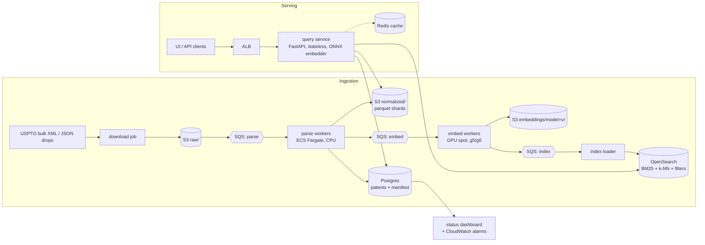

# Part 2: Patent search at 10 million patents

This document describes how to run the Part 1 search engine over the full ~10M-patent corpus. It is
written so that someone new to the project can start building it. It picks simple, managed
components and lists their weak points at the end. The local proof of concept for the ingestion
control plane is in [`poc/`](poc/) (see the last section).

## 1. What we are building

The Part 1 engine, unchanged in behaviour:

* **Inputs:** a natural-language query, a claim, or a patent number (its independent claims become
  the queries).
* **Hybrid filters:** classification prefix, keywords in title/abstract (with `tire*` wildcards), title
  phrase or exact title, and a date range.
* **Ranking:** BM25 and semantic vector search, fused with reciprocal rank fusion (RRF).
* **Output:** ranked patents, each with its best-matching claim or paragraph as evidence (a claim
  chart when the input is a patent).

**Targets:** 10M patents searchable. A filtered or unfiltered query returns in p95 < 500 ms,
including query embedding. Each weekly USPTO release is searchable within 6 hours of
publication. A full re-embed with a new model can be done in under 2 days without downtime.

## 2. Sizing (from the 457k-patent sample, scaled ×22)

| per patent (measured) | value | at 10M patents |
|---|---|---|
| raw JSON | ~68 KB | **~680 GB** raw |
| title + abstract | ~0.75 KB | 7.5 GB |
| claims | ~6.4 KB, 18 claims (2.7 independent) | 64 GB |
| detailed description | ~60 KB, ~115 paragraphs | 600 GB |
| "core" chunks (title+abstract, independent claims) | 3.7 | **37M vectors** |
| "full" chunks (+ all claims + description passages) | ~120 | ~1.2B vectors |

Vector memory for 37M × 384-d vectors:

| storage | memory |
|---|---|
| fp32 | 57 GB |
| fp16 | 28 GB |
| int8 (SQ8) | 14 GB |
| PQ-64 | 2.4 GB |
| HNSW graph (M=32), on top of the vectors | ~10 GB |

**Decision:** index the **core chunks** for retrieval, as Part 3 does locally. Description
passages are *not* stored in the vector index. Instead, evidence paragraphs for the final top-k are
scored on the fly (§4.4). 1.2B passage vectors would cost roughly 30× more RAM for a feature
that only the top 10–30 results need.

## 3. Architecture



### Components

| component | choice | why / notes |
|---|---|---|
| Object store | **S3** | Source of truth for raw files, normalized parquet shards (all fields including descriptions) and embeddings, versioned by model. Everything else can be rebuilt from S3. |
| State + metadata DB | **Postgres (RDS)** | Job manifest, dedup (`doc_number` primary key), patent metadata and claims for display, index catalog. One DB for both control plane and metadata keeps it simple. |
| Queue | **SQS** (one queue per stage, plus a dead-letter queue each) | Visibility timeout gives the same lease and re-delivery behaviour as the PoC. The job *status* still lives in Postgres, so it can be queried. |
| CPU workers | **ECS Fargate** tasks running `patent_search.data.process_file` | The Part 1 cleaning/chunking/tokenizing code is reused as is. |
| GPU workers | **ECS on EC2 g5.xlarge spot** running `Embedder` (bge-small-en-v1.5, fp16) | Spot is fine because jobs are idempotent and leased. |
| Search engine | **OpenSearch** (managed) with `text` fields (BM25), `knn_vector` (faiss HNSW, fp16), `keyword` cls, `date` | One system answers filter + BM25 + k-NN. Its k-NN "efficient filtering" chooses between exact pre-filtering and filtered HNSW by candidate count, which is what our planner does (thresholds measured in Part 3). |
| Query service | **FastAPI** on Fargate behind an ALB | Embeds the query with an ONNX bge-small on CPU (~10 ms for a short query), sends BM25 and k-NN requests to OpenSearch in parallel *with the same filter*, fuses with RRF and fetches evidence. A port of `index.py`. |
| Cache | Redis (optional) | Query embedding and result cache; patent-number queries repeat often. |
| Monitoring | CloudWatch metrics/alarms + the manifest dashboard | See §6. |

## 4. Pipelines

Every job is keyed by `(stage, shard_id, version)`, writes its output atomically (to a temp key,
then renamed or committed) and is safe to run twice. That one rule makes retries, spot
interruptions and backfills simple.

### 4.1 Backfill (one time, 10M patents)

1. **List:** enumerate raw files into `ingest_files` (uri, size, checksum) and enqueue one `parse`
   job per ~1,000-patent file.
2. **Parse:** run `process_file` to validate, clean, chunk and tokenize. Then:
   * Write `normalized/shard=N.parquet`, keeping all fields.
   * Upsert into `patents`, deduplicating by `doc_number` and keeping the most complete copy (the
     same rule as Part 1). The sample had 3% duplicate copies, all identical or differing only in
     description length.
   * Write per-record failures to `bad_records`. They do not fail the file.
   * Enqueue an `embed` job for the shard.
3. **Embed:** encode the shard's core chunks and write `embeddings/model=bge-small-v1.5/shard=N.npy`.
   Enqueue an `index` job.
4. **Index:** bulk-load the shard's patents and vectors into the *new* index
   `patents_v{n}`. Bulk load with replicas=0 and refresh disabled, then enable replicas and refresh
   at the end.
5. **Validate and swap:** check that doc counts match `patents` and that a canary query set returns
   its expected results (recall@10 ≥ threshold). Then point the alias `patents` at `patents_v{n}`.

### 4.2 Incremental (weekly)

A scheduled job downloads the Thursday USPTO release and runs the same parse → embed → index
stages. A release is ~7–8k applications, so this takes minutes and could even run without a GPU.
Upserts go into the *live* index. A republished `doc_number` (a correction) replaces the old copy.

### 4.3 Re-embedding (new model)

Never mutate the live index for a model change. Run embed jobs for all shards under a new
`model=` prefix, build `patents_v{n+1}` offline, validate, swap the alias and keep the old index for
a week as instant rollback. Raw and normalized data are reused, so only the GPU stage re-runs.

### 4.4 Query path

1. Parse the request.
2. Embed the query, or for a patent number fetch its independent claims from Postgres and embed
   up to 10 of them.
3. Send in parallel: a k-NN query with the filter (top ~400 chunks, grouped to ~100 patents) and a
   BM25 query with the same filter (top 100).
4. Fuse with RRF and take the top-k.
5. **Evidence:** load the top-k patents' passages from S3 parquet (or a Postgres passages table)
   and score them against the query vector(s) in memory. That is k × ~120 dot products, under
   5 ms. Return the best claim or paragraph per query row.
6. If OpenSearch k-NN times out, degrade to BM25-only and flag the response. If BM25 fails, fall
   back to dense-only.

## 5. Data model (Postgres)

```sql
CREATE TABLE patents (
  doc_number   text PRIMARY KEY,
  title text, abstract text,
  classification text[],              -- real data has several codes per patent; the sample has one
  pub_date date, date_precision text,  -- 'day' | 'year' (the large sample only has the year)
  claims jsonb,                        -- [[num, text, is_independent], ...]
  quality int, content_hash bytea, source_file text,
  version int NOT NULL DEFAULT 1, updated_at timestamptz DEFAULT now()
);
CREATE TABLE ingest_files (id bigserial PRIMARY KEY, uri text UNIQUE, bytes bigint, checksum text, seen_at timestamptz);
CREATE TABLE jobs (                    -- same shape as poc/pipeline.py
  id bigserial PRIMARY KEY, stage text, input text, output text, version text,
  status text CHECK (status IN ('pending','running','done','failed')),
  attempts int DEFAULT 0, not_before timestamptz, lease_owner text, lease_expires timestamptz,
  error text, n_in int, n_out int, n_dropped int, created_at timestamptz, started_at timestamptz, finished_at timestamptz,
  UNIQUE (stage, input, version)
);
CREATE TABLE bad_records (file_id bigint, record_idx int, doc_number text, reason text, excerpt text);
CREATE TABLE index_versions (name text PRIMARY KEY, model text, doc_count bigint, built_at timestamptz,
                             canary_recall real, is_live boolean);
```

## 6. Errors, tracking and status

**Failure handling**

| failure | handling |
|---|---|
| Worker crash or spot interruption | The lease or visibility timeout expires and another worker re-runs the job. Outputs are idempotent. |
| Transient error (S3 timeout, throttling) | Retry with exponential backoff, up to 4 attempts. Then status `failed` and a message to the dead-letter queue, with the last error stored. |
| Permanent error (corrupt file, schema violation) | Dead-lettered on the first attempt (`PermanentError`), no retries. |
| Bad record inside a good file | Logged to `bad_records`. The file still succeeds. |
| Duplicate `doc_number` | Upsert keeps the most complete copy. Dedup is part of the data model, not a cleanup job. |
| DB/index drift (a crash between the Postgres commit and the OpenSearch write) | A nightly reconciliation job compares `doc_number` sets by shard and re-enqueues `index` jobs for any differences. |

**Tracking what is in the system**

* `jobs` answers "what stage is shard N in, how many records went in and out, and what failed".
* `index_versions` records which model built the live index and what its canary recall was.
* Counts must reconcile at every stage: `records_in = kept + invalid + duplicates`. A mismatch is
  an alarm.

**Dashboard and alarms.** The [`poc/`](poc/) dashboard covers progress, throughput, ETA, workers,
dead letters and recent events. In production, add CloudWatch alarms on:

* dead-letter queue depth > 0
* ingest lag (newest USPTO week not yet searchable) > 6 h
* query p95 > 500 ms, or error rate > 1%
* canary recall drop > 5 points (an hourly fixed query set with known answers)
* OpenSearch JVM / k-NN native memory > 85%

## 7. Cost (rough, AWS us-east-1 on-demand list prices; verify with the AWS calculator)

**Steady state, per month**

| item | sizing | ≈ $/month |
|---|---|---|
| OpenSearch | 3 × r6g.2xlarge.search (64 GB RAM each) + 3 × 300 GB gp3. HNSW over 37M fp16 vectors ≈ 38 GB per copy, ×2 with 1 replica, fits in the k-NN memory budget | 1,600 |
| RDS Postgres | db.r6g.large + 500 GB gp3 (patents + claims ≈ 80 GB, manifest is tiny) | 230 |
| Query service | 2 × Fargate (2 vCPU / 4 GB) + ALB | 150 |
| S3 | ~1 TB (raw 680 GB, parquet ~150 GB, core embeddings 28 GB per model version) | 25 |
| Weekly ingestion | a few CPU task-hours; CPU embedding is enough for ~30k chunks/week | 10 |
| Monitoring and logs | CloudWatch | 50 |
| **Total** | | **≈ $2,100 / month** |

**One-time backfill**

| item | estimate | ≈ $ |
|---|---|---|
| Parse 680 GB | Measured locally at ~80 MB/s per core. 64 vCPU of Fargate spot for about 1 h, mostly S3-read bound | 5 |
| Embed 37M core chunks | Assumes 2.5k chunks/s per A10G for bge-small fp16 (to be benchmarked first; an M2 Pro does 355/s), so ~4 GPU-hours on g5.xlarge | 5 |
| Embed full passages (1.2B), if ever needed | ~130 GPU-hours | 130 on-demand / ~50 spot |
| HNSW build and bulk indexing | Temporarily scale OpenSearch up for ~a day | 100 |
| **Total** | | **< $300** (embedding is the cheap part; RAM for the index is the expensive part) |

**Cheaper phase-0 option:** a single r7i.4xlarge (128 GB) running Postgres + faiss/Qdrant + this
repo's engine costs ≈ $600/month. It has no high availability, but it is perfectly usable for an
internal tool.

## 8. Known challenges at scale

1. **Index RAM is the cost driver.** HNSW wants the vectors in memory. Options, in order:
   * fp16/int8 scalar quantization (int8 IVF measured: 4.6× less memory than HNSW, 0.98 recall@10 at nprobe=128)
   * IVF-PQ with re-ranking (≈20× less)
   * DiskANN-style on-disk graphs

   Part 3 measures some of these tradeoffs.
2. **Filtered ANN is the hardest problem.** Measured on the 1.67M-vector sample, bitmap-filtered HNSW:
   * keeps 0.995 recall@10 when ≥ 35% of vectors pass;
   * drops to **0.11–0.84 recall** when only 0.07–15% pass, even though it stays fast (2–5 ms).

   Our planner brute-forces up to 300k candidate chunks instead (≤ 40 ms, exact). At 10M patents,
   300k chunks is under 1% selectivity, so a wide 1–30% band would fall into filtered-HNSW
   territory. Mitigations:
   * partition the index by CPC section/subclass, so common classification filters become a
     smaller index instead of a filter;
   * raise `efSearch` in proportion to 1/selectivity;
   * use OpenSearch's efficient filtering, tuning its exact-search threshold upward based on these
     measurements;
   * GPU brute force for candidate sets up to a few million vectors.

   A canary query set with filters must check recall, not just latency.
3. **Hybrid fusion across two engines.** BM25 and k-NN must apply the *identical* filter, or RRF
   fuses inconsistent candidate sets. Build the filter once in the query service and reuse it.
4. **Passage evidence without 1.2B vectors.** Score on the fly for the top-k. If latency matters,
   cache passage vectors for frequently returned patents, or store passage vectors PQ-compressed
   (~60 GB).
5. **Long claims.** The model truncates at 256 tokens. On the sample, 13.7% of independent claims (median 139 tokens) and 3.3% of title+abstract texts are longer.
   Split long claims into overlapping windows, or move to a long-context embedding model at
   re-embed time.
6. **Data quality.**
   * Duplicates, missing descriptions, `N/A` classifications (38% of the sample) and inconsistent
     code formats (`B60B304FI` vs `H01L21/0234`).
   * Normalize at parse time and keep counts per reason.
   * Multiple classification codes per patent need an array field.
7. **Re-embedding and index versioning.** Use blue/green indexes behind an alias, never in-place
   updates.
8. **Consistency between Postgres and OpenSearch.** There is no distributed transaction, so make
   writes idempotent and run the nightly reconciliation (§6).

## 9. Implementation plan for an intern

1. `docker compose` with Postgres, OpenSearch and MinIO. Create the schema from §5.
2. Port `poc/pipeline.py` from SQLite to Postgres. The claim query becomes
   `UPDATE ... WHERE id = (SELECT ... FOR UPDATE SKIP LOCKED) RETURNING`. Optionally swap the
   polling for SQS.
3. Parse worker: reuse `patent_search/data.py:process_file`. Write parquet to MinIO and upsert into
   `patents`.
4. Embed worker: reuse `patent_search/embed.py`. Write `.npy` shards.
5. Index loader: create the OpenSearch mapping (`title`/`abstract`/`claims` as text,
   `classification` keyword, `pub_date` date, `chunks` as nested `knn_vector`, faiss HNSW, fp16)
   and bulk-load.
6. Query service: port `PatentIndex.search` to two OpenSearch queries plus RRF. Keep the response
   format so the existing UI (`patent_search/static/index.html`) works unchanged.
7. Dashboard and alarms. Then dry runs at 1%, 10% and 100% of the backfill. Check counts and canary
   recall at each step.

## 10. Proof of concept (`poc/pipeline.py`)

This is a working local version of the ingestion control plane in §4 and §6. It deliberately uses
SQLite instead of Postgres/SQS so that it runs anywhere.

* **Durable job table:** an atomic `UPDATE ... RETURNING` claim, leases renewed by a heartbeat
  thread, idempotent enqueueing (`UNIQUE(stage, input)`).
* **Two-stage DAG:** finishing a `parse` job enqueues an `embed` job for its shard, and each stage
  has its own worker pool (CPU parsers vs. one GPU embedder).
* **Failure handling:**
  * retries with exponential backoff
  * dead-lettering after 4 attempts
  * permanent errors (a deliberately corrupt file) dead-lettered immediately
  * a supervisor that restarts crashed workers
* **`--chaos p`** injects transient errors and *hard process kills* mid-job, to show that leases
  expire and other workers take the jobs over.
* **Live dashboard** (`poc/pipeline.py dashboard`): per-stage progress, throughput, ETA, retries,
  worker heartbeats, dead letters and an event log.

```bash
python poc/pipeline.py init --data data/large --limit 24
python poc/pipeline.py dashboard &          # http://127.0.0.1:8001
python poc/pipeline.py run --parse-workers 4 --embed-workers 1 --chaos 0.15
```
